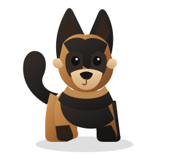

# DesktopPet

A little German Shepherd that lives on your desktop. **DesktopPet is a passion project**: a small, personal experiment in making the desktop feel a bit more alive. It is being built in the open, with plenty of room for polish and contributions.



*The illustration above is the pet's transparent cutout artwork. The running app adds movement and interaction.*

## Which branch should I download?

**Download `feat/desktop-pet-interactions` for the latest prototype described here.** The interaction work has not been merged into `main`, so the `main` branch may not contain all the features and fixes described in this README.

Clone the recommended branch directly:

```bash
git clone --branch feat/desktop-pet-interactions https://github.com/sarkarshivaditya-lab/Desktoppet.git
cd Desktoppet
```

If you are browsing GitHub, use the branch selector above the file list and choose `feat/desktop-pet-interactions`. Use `main` only if you specifically want the current main-branch snapshot.

## What it does

- A transparent, frameless desktop companion that stays above ordinary windows.
- Eye movement and blinking.
- Tail and limb animation, plus a gentle idle state.
- Click to pet, and drag the dog to reposition it.
- Gentle roaming around the current monitor.
- Resizable native window.
- On macOS, native cursor tracking lets the eyes follow the pointer while another app is focused.

**Current limitations:** this is an active prototype, not a polished release. Global cursor tracking is currently implemented for macOS; Windows falls back to pointer movement delivered to the pet window. Typing reactions only respond to key events delivered to the pet window, not typing in other apps. Perching on other application windows is not implemented yet. The project has not been verified on every macOS/Windows configuration.

## Download and install

### Ready-to-install builds

Check the repository's [Releases page](https://github.com/sarkarshivaditya-lab/Desktoppet/releases) for packaged installers. If no release assets are published yet, use the build-from-source steps below. Do not download or run an installer from an unofficial mirror.

### Build from source — macOS

#### 1. Install prerequisites

Install:
- [Node.js LTS](https://nodejs.org/)
- [Rust](https://www.rust-lang.org/tools/install) using rustup
- Xcode Command Line Tools

Open Terminal and install the Apple command-line tools if needed:

```bash
xcode-select --install
```

After installing Node.js and Rust, close and reopen Terminal, then check:

```bash
node --version
npm --version
rustc --version
cargo --version
```

#### 2. Download the project

```bash
git clone --branch feat/desktop-pet-interactions https://github.com/sarkarshivaditya-lab/Desktoppet.git
cd Desktoppet
npm install
```

#### 3. Run the development app

```bash
npm run tauri -- dev
```

Keep the terminal open while using the development app. Stop it with `Ctrl+C`.

#### 4. Build a macOS installer

```bash
npm run tauri -- build
```

When the build succeeds, look under:

```text
src-tauri/target/release/bundle/dmg/
src-tauri/target/release/bundle/macos/
```

Open the generated DMG and drag DesktopPet into Applications if the disk image contains an app bundle. A locally built app may not be signed or notarized, so macOS may show a security warning. Only run a build you trust.

### Build from source — Windows

#### 1. Install prerequisites

Install:
- [Node.js LTS](https://nodejs.org/)
- [Rust](https://www.rust-lang.org/tools/install) using rustup
- [Microsoft C++ Build Tools](https://visualstudio.microsoft.com/visual-cpp-build-tools/) with the **Desktop development with C++** workload
- [Microsoft Edge WebView2 Runtime](https://developer.microsoft.com/microsoft-edge/webview2/)

Restart the terminal after installing the prerequisites. Open PowerShell and check:

```powershell
node --version
npm --version
rustc --version
cargo --version
```

#### 2. Download the project

```powershell
git clone --branch feat/desktop-pet-interactions https://github.com/sarkarshivaditya-lab/Desktoppet.git
Set-Location Desktoppet
npm install
```

#### 3. Run the development app

```powershell
npm run tauri -- dev
```

Keep the terminal open while using the development app. Stop it with `Ctrl+C`.

#### 4. Build a Windows installer

```powershell
npm run tauri -- build
```

When the build succeeds, the NSIS installer should be under:

```text
src-tauri\target\release\bundle\nsis\
```

Run the generated `.exe` installer to install DesktopPet.

## Useful development commands

Run the frontend in a browser for UI work (native desktop features will not be available):

```bash
npm run dev
```

Check TypeScript and build the frontend:

```bash
npm run build
```

Run the native desktop app:

```bash
npm run tauri -- dev
```

Create a release bundle for the operating system you are currently using:

```bash
npm run tauri -- build
```

Build and test on the target operating system. A macOS build does not produce a Windows installer, and a Windows build does not produce a macOS DMG.

## Tech stack

- [Tauri 2](https://v2.tauri.app/) for the native desktop shell.
- Rust for native platform integration.
- TypeScript and [Vite](https://vite.dev/) for the frontend.
- Original German Shepherd SVG artwork and CSS animation.

## Bug tracking

Reported issues, source audits, file-level fixes, and verification status are recorded in the [Bug & Regression Tracking Log](BUG_TRACKER.md). Please update this log when investigating a bug or changing files to fix one.

## Contributing

This is a passion project, and thoughtful bug reports, testing on different machines, and focused pull requests are welcome. Please include your operating system, version, steps to reproduce, and relevant terminal output when reporting a problem. Avoid submitting secrets, personal data, or unrelated changes.

Before making changes, read [AGENTS.md](AGENTS.md), the project [checkpoint](checkpoint.md), and the local [Ponytail skill](skills/ponytail/SKILL.md). Development work for the current interaction milestone belongs on `feat/desktop-pet-interactions`; do not make unrelated changes directly on `main`.

## Project status

DesktopPet is still under active development. Native drag, roaming, global cursor tracking, animation, packaging, and accessibility behavior need real-world testing on supported systems. Please treat the README's commands as build instructions, not as a claim that every platform has already been validated.
